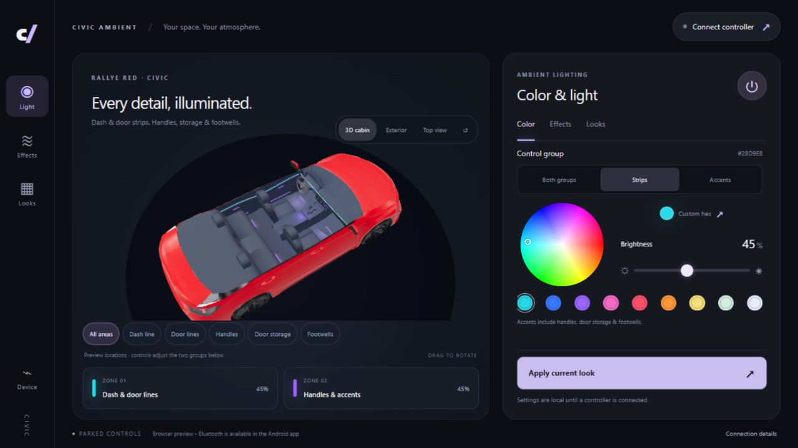

# Civic Ambient Lighting Controller

An Android Automotive app for the Bluetooth lighting controller used by the inspected Dynamic ambient lighting APK. Built for the 2027 Civic Sport Touring Hybrid head unit, with an original dark dashboard and a detailed 3D Civic cabin/exterior preview. This project is not affiliated with Honda, BMW, or the lighting vendor.



## Included

- Nearby BLE scan, explicit device selection, service/characteristic validation, manual connection/disconnection.
- Two RGB zones: linked or independent color and brightness, color wheel, exact RGB hex entry, and quick palette.
- Power, six RGB effects, eleven flow modes, variant, speed, and direction controls. Flow commands are controller-wide; RGB modes can differ by zone.
- Six built-in looks and up to twelve named custom presets stored locally on the head unit.
- Offline, bundled WebGL 3D preview: cabin cutaway, exterior, and top view, drag to rotate, mouse-wheel zoom on desktop, reset view, dash line, four door lines, four handles, door-storage pockets, and front/rear footwell illumination. A fallback message leaves controls usable if WebGL2 isn't available.
- Civic 2022 model by Ricy (@ngon_3d), used under CC BY 4.0, with converted PBR materials and a Rallye Red-inspired exterior. The geometry is an artist’s 2022 model, not an exact 2027 Sport Touring Hybrid replica. Two group labels follow the inspected installation guide: strips (dash/door lines) and accents (handles, door storage, footwells). Confirm the actual routing on your kit. Preview location buttons highlight these five areas; they do not send commands or provide individually addressed control. The center console is unlit. The model is not an exact Civic replica. Effect motion is generated by the physical controller; the 3D model previews the selected colors and brightness.

No RPM, drive-mode, gear, OBD, OEM-service discovery, network transfer, telemetry, cloud account, or Internet permission is included. Vehicle integration is outside this version's scope. The UI is parked-only under AAOS restrictions; no distraction-optimized declaration or driving-lockout bypass is used. Connections may survive a paused activity while its process lives, but no persistent background service is provided.

## First hardware test

1. Close the original phone lighting app so it releases the controller connection.
2. Open Civic Ambient while parked. Select **Connect controller**, allow Nearby devices, then **Scan nearby**.
3. Choose the lighting controller. The app only enables writes after finding service `FFC0` with a write-without-response `FFC1` characteristic. When a notify/CCCD channel is available, it configures it before declaring readiness.
4. Start with a solid color and modest brightness. **Apply current look** sends the locally selected settings. Changing a color, preset, effect, or released slider also submits the new settings when connected.
5. Confirm the actual zone wiring and physical changes. BLE write submission is not controller acknowledgement; the app does not claim authoritative device state readback.

Connect sends only the original protocol's initialization/status requests. It does not automatically apply saved colors or power settings. Disconnect/reconnect discards pending writes. Changing another control replaces pending configuration commands with the newest complete look. Writes are paced 160 ms apart; transport failures clear the queue and require a fresh manual connection. No state is replayed to a different device.

## Build

Open this repository in Android Studio (JDK 17+, SDK 35), or run:

```powershell
.\gradlew.bat assembleDebug
.\gradlew.bat bundleRelease
```

The Gradle release bundle is unsigned until you configure your own signing. No signing key or password is included. The app retains package `dev.civic.signalcheck`, version code **7**, version **0.2.1**, so a correctly signed Play release can update the earlier diagnostic app. Its new display name is **Civic Ambient**. Installing the standalone development APK over a Play-signed install can fail because the signing keys differ; use the Play internal track for that upgrade.

`tools/build-local.py` is an alternative Windows build using unpacked official Android SDK packages, a JDK, and optional bundletool. Run `python tools/build-local.py --help`. It writes artifacts to `dist/` by default; scratch files and generated development keys must remain outside version control. It uses the development keystore alias `diagnostic` and development password `android` when signing locally. This is not a production secret-management scheme.

## Desktop UI preview

```powershell
python -m http.server 8765 --bind 127.0.0.1 --directory app/src/main/assets
```

Open `http://127.0.0.1:8765`. This serves the exact bundled UI and 3D scene. The desktop preview is explicitly disconnected and cannot control Bluetooth hardware; presets there are stored in that browser only. Android uses a restricted local WebView asset origin and a narrow native BLE bridge, with files, content access, remote navigation, and mixed content blocked.

## Verification

`tests/ProtocolTest.java` checks known packets, invalid inputs, two-zone preservation, linked zones, preset roundtrips, and power preservation. Its 10,515 generated packets are compared by `tests/compare_protocol.py` against the earlier APK-derived encoder. All comparisons passed. See `docs/VALIDATION.md` for build and UI checks and remaining hardware limitations.

Protocol details and provenance are in `docs/Bluetooth-protocol.txt`. The protocol is reconstructed from `com.findn.htx` 1.1.1; compatibility with other app/controller revisions is unverified. No original lighting-app binary, graphics, or signing key is bundled. The third-party Civic mesh is credited separately.

Third-party renderer: Three.js **0.170.0**, bundled locally under the MIT license at `app/src/main/assets/vendor/THREE-LICENSE.txt`. The Gradle wrapper is from Gradle **8.9**. The matching GLTF loader, geometry utilities, and studio environment are bundled under that same MIT license. There are no runtime CDNs.

Civic mesh: [Honda Civic 2022 (Free Download)](https://sketchfab.com/3d-models/honda-civic-2022-free-download-d5ca29a5d2f341b691118ffb5560b19b) by [Ricy / ngon_3d](https://sketchfab.com/ngon_3d), [CC BY 4.0](https://creativecommons.org/licenses/by/4.0/). Attribution and modifications are listed in `app/src/main/assets/models/CIVIC-LICENSE.txt` and in Connection details. `tools/prepare-civic-model.py` reproduces the material conversion from the creator’s downloaded GLB. The model includes embedded textures; asset reads remain local to the bundled WebView origin.
